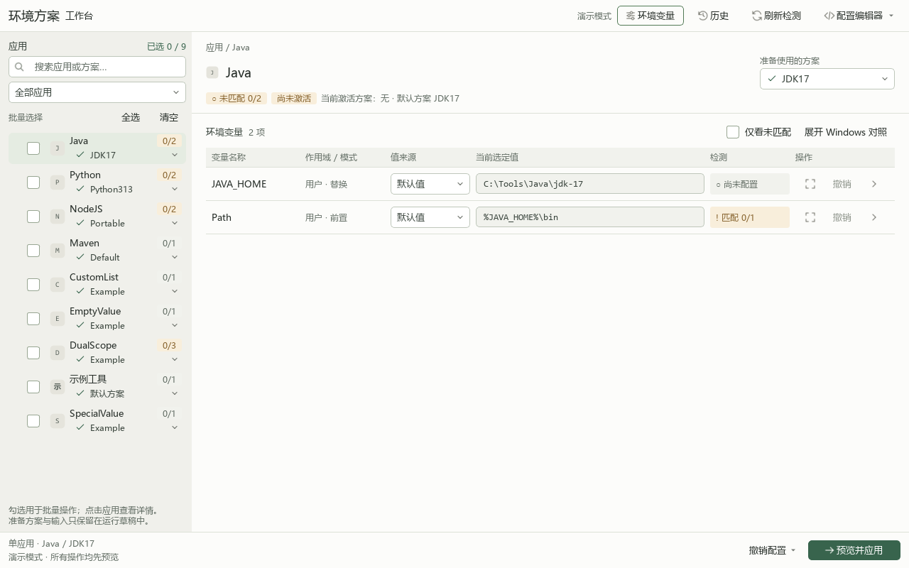

# Windows ������������������ V2

V2 ������ Windows 10/11 ��ȫ��ʵ�֣�����Ӧ�� �� ���� �� ���������� User �� System ���������������ļ�ֻ���淽�����壻ѡ��ݸ塢�ɹ�Ӧ��ֵ��ִ�лָ���¼�ɶ���״̬�Ᵽ�档

**[���� Windows ��װ��](https://github.com/yuri368/windows-environment-manager-v2/releases/latest/download/EnvironmentManagerV2-2.0.0-windows-x64-setup.exe)** �� [�汾��Դ��](https://github.com/yuri368/windows-environment-manager-v2/releases)

˫����װ����ɺ󼴿ɴ� GUI���������� Python �� Qt�����谲װ����������֧�� Windows 10 1809 ����°汾 / Windows 11 x64��



## �����

��ͨ�û��� GitHub Release ���� `EnvironmentManagerV2-2.0.0-windows-x64-setup.exe`��˫���������İ�װ�򵼡��������� Python �� Qt����װ��ɴ������ʼ�˵��� GUI�����ҳĬ�Ϲ�ѡ��������������ʹ����ʽ����ʱ����׼ Windows UAC ��ʾȷ�Ϲ���ԱȨ�޼��ɣ��������������װ����������

��װ��ĸ������ñ����� `%LOCALAPPDATA%\EnvironmentManagerV2\config\env.toml`���״����д�����ʾ���������������ñ༭���а�ʾ��·���ij�ʵ�ʰ�װ·������װ����������д Windows ����������Ҳ���Ḳ�Ǹ������á������ Python �����������ű�˵������Դ�����м������ߡ�

- Windows 10 1809 ����°汾 / Windows 11����ǰ��װ��Ϊ x64
- Python 3.11 ����°汾
- PySide6 6.11.2
- tomlkit 0.13.3

˫�� `����.cmd` ���ڱ�Ŀ¼���� `.venv`����� Python �汾�Լ� PySide6��tomlkit �ĵ���Ͱ汾��ȱ�ٻ�汾����ʱ��װ `requirements.txt` �е���������ʽ GUI �������ȼ�����Ա���ƣ��ٴ��� Qt ���桢�����״̬�⣺���й���ԱȨ�޾ͼ�������ͨȨ��ʱͨ����׼ UAC ��ʾ����ͬһ Python �������������������������в����͵�ǰĿ¼��ȡ�� UAC����Ȩ����ʧ�ܣ�������������δȡ�ù���ԱȨ��ʱ����ʾ����ֹͣ�����ظ���Ȩ����������ֻ����ʽ������·��������`-Demo`��`-Check` �� `-CheckAdmin` ������ UAC������ GUI ʹ�����ش��ڡ�Ҳ��������ĿĿ¼���У�

```powershell
.\����.cmd
```

�޹���ԱȨ��ʱ��`����.cmd -CheckAdmin` ��ֻ����⵱ǰ�����Ƿ��������������������˳��� `0`��δ�������� `1`�����ᴥ�� UAC��`����.cmd -Check` ��У�����ã���Ӧ�ñ���������Ȩ����������Ҳ��ͨ�� `launcher.ps1` ʹ�á�

���������Ϊ `python -m envmanager`�����Ѽ�������⻷���п�ʹ�ã�

```powershell
python -m envmanager --check
python -m envmanager --check-admin
python -m envmanager --demo
python -m envmanager --demo --screenshot C:\Temp\envmanager-demo.png
python -m envmanager --config .\env.toml --state-dir .\local-state
```

`--screenshot` ������ `--demo` һ��ʹ�á���ʾģʽʹ����ʱ״̬��ģ��洢������ȡ��д�뱾��ע�����`--check` У�����ò��������⣬��Ӧ���κα�����`--check-admin` ֻ����⵱ǰ���̵Ĺ���ԱȨ�ޣ������������˳��� `0`��δ�������� `1`���������� UAC��

��������֧�� `-Demo`��`-Config <·��>`��`-StateDir <·��>`��`-Check` �� `-CheckAdmin`��

```powershell
.\launcher.ps1 -Demo
.\launcher.ps1 -Config 'D:\����\����.toml'
.\launcher.ps1 -Demo -Config .\env.example.toml
.\����.cmd -Check
.\����.cmd -CheckAdmin
.\launcher.ps1 -Demo -Config .\env.example.toml -StateDir .\demo-state
```

������Ե� `-Config` �� `-StateDir` ʱ��������������ʱ����Ŀ¼��������ʽ GUI ʹ�õ� `-Config` �� `-StateDir` ���� UAC ����������`-Check` ͬ��ִ������У�飬�˳����ʾУ������`-CheckAdmin` �����ص�ǰȨ�޼����������Ȩ��

## ����

`env.toml` �DZ����������ã��Ѽ��� `.gitignore`������Դ�뷢�����״���ʽ����ʱ�����Ĭ�����ò����ڣ���� `env.example.toml` ����һ�� `env.toml`�����������ñ༭���а�ʵ�ʰ�װ·���޸IJ����棬��Ԥ��Ӧ�á����и������ò��ᱻ���ǣ���ʽָ���� `--config` ·��Ҳ�����Զ��������滻��Ĭ����ʾģʽʼ��ʹ��ʾ�����ã�`--check` ��Ĭ��������δ����ʱֻ��У��ʾ�����������ļ���

Դ������Ĭ�϶�ȡ��ĿĿ¼�е� `env.toml`����װ���ȡ���ĵĸ�������Ŀ¼�����ð� TOML 1.0 ��д������ `[Ӧ����.������]` ���飬ÿ����������Ӧһ����¼��Ӧ�ñ����� `default_option` ָ��Ĭ�Ϸ��������ֶ��DZ���Ԫ��������ֵ��������ͬһӦ����ʵ�ʴ��ڵķ�����δָ��ʱ���ݾ����ã�ʹ�ø�Ӧ�õĵ�һ��������

```toml
[Java]
default_option = "JDK17"

[Java.JDK17]
JAVA_HOME = { default_value = 'C:\Tools\Java\jdk-17', scope = "User", mode = "replace", editable = false }
Path = { default_value = '%JAVA_HOME%\bin', scope = "User", mode = "+append", editable = false }
```

֧�� `replace`��`+append`��`-append` �� `append` ���ֲ�����ͬһĿ��ֻ�� `+append`/`-append` ʱ��ϵͳ��ǰ���δƥ��������������ϳɽ��������Ҫ����������ͬһ�����Դ�Сдƥ����б���ͬʱ��Ҫ��ǰ�úͺ��ã������������Գ�ͻֹͣ��ͬһĿ����� `append` ʱ���������������ϲ�Ϊһ�������б�ͳһ����һ�Σ�ȷ�Ϻ��˳��������ս��������Ҫ����Լ������λ�á���ͬ��������ͬ��������Լ��������`replace` ������ͬ��ɺϲ�����ͬ���ͻ��`replace` ��׷�Ӳ���ָ��ͬһĿ��Ҳ���ͻ�������ȷ�ϱ�������д�� Windows��

���ú�����״̬���룺ͳһѡ��������ѡ��Ĭ��ֵ���ϴγɹ�Ӧ��ֵ����ѡֵ�������༭ʱ���Զ���ֵ��ÿ����ʽ����ʱ��ÿ��Ӧ��ʹ�����һ�γɹ�Ӧ�ü�¼�еķ�������Դ��ѡ�������ʼ����û����ʷʱʹ��Ĭ�Ϸ������������� `default_value`���������û��޸ĵ�ѡ�񱣳��������У����Ӧ�ò��Ḳ����Щѡ�񣻳ɹ�Ӧ�òŸ��³ɹ�ƫ�á���ѡֵƫ�ð� `label` �� `value` ���沢�ڼ���ʱ���飬�����ѡ�����ź�ѡ��ֵ������Դ�ı䵫��ʷ�����ԺϷ�ʱ������ʷ���벢��ʾ����ʷ���벻�ٺϷ�ʱ���˵�Ĭ��ֵ��ֻѡ���༭�����д TOML��

### ���ñ༭��

�����������ϽǴ򿪡����� �� ���ӻ��༭�����������ѡ��Ӧ�á������ͱ�����Ӧ��ʹ�ñ�ƽ���������������û�/ϵͳ������ֱ���ʾ��Ӧ�ø���ժҪ���Ҳ�ķ���ѡ�����г���ȫ���������͵�ǰӦ�õ����з�����ѡ����巽�������÷���������ͬ����෽����ѡ��ȫ���������ص���ǰӦ�õľۺϸ��������ı���൱ǰ���������ģ����������ɾ������Ĭ�Ϸ�������������൱ǰ��������ʹֻ��һ������Ҳ��ʾѡ�����������༭ҳ�������ظ�ѡ��������������ȫ��Ӧ�á������ͱ�����ƥ�����������������ֱ�Ӷ�λ��Ӧ���뷽�������Ա�����Ӧ�á������ͱ������Եı�����ֱ�Ӳ���������ɾ����ڣ�����ѡ�����·����С���ΪĬ�Ϸ�������������ťͳһʹ�ü�����֣���ʾ�б�����������˵����`default_value`��`scope`��`mode`��`editable` �ͺ�ѡ�ֶ���ѭ���ļ������� TOML ���ù淶��ͬ�� User/System ˫�������¼�ֱ�༭����������һ��˫�������¼���档

ѡ��һ�������󣬵������ΪĬ�Ϸ��������²ݸ壬�ٱ������ü�����Ч����������๴ѡ���Ӧ�ã�ÿ�п�ֱ��ѡ�񷽰����ײ���Ԥ����ѡӦ�á�ͳһԤ����ЩӦ�õ�ǰѡ���ȫ�����������Ӧ������ֻ�л����飬��ѡ״̬�ᱣ�����ο�ֵĬ���۵�����������Ҳ��ͷ�ɲ鿴Ĭ��ֵ���ϴ�Ӧ��ֵ�� Windows ʵ��״̬����Ч�������嵥�͵ײ���ʾ�������á���λ���롱ֱ��������

���������Ͻǵġ�������������ťֱ�Ӵ� Windows ԭ�������������ã����ڲ鿴�û�����ϵͳ�����������������ʾ������Ҳ��򿪱�����ʵ���ã��򿪶����������޸ı������� Windows �������޸����ݺ󣬻ص������������ˢ�¡�������ִ���Ի����¼��ʵ��״̬�ͳ�ͻ��

�����༭���������´˱��������빲���ݸ壻������δ���¡��ݸ���δ�������ļ���ͬ���ֱ���ʾ���л�Ӧ�á��������������������ʱ��δ���µ������ɵ����������������Գ������������鿴 TOML ���죬����У������ȷ���档ɾ�����һ��������¼ʱ���Զ�������յķ�����Ӧ�ã��������ٱ���һ����Ч������¼����˿����ò��ܱ��档�༭�����޸� TOML����д�� Windows ����������Ҳ����� SQLite ״̬���ⲿ�����ڱ༭�������޸��������ļ�ʱ���༭������ֹ���Dz�Ҫ���������롣

������ �� �༭ԭʼ TOML����ֱ�Ӵ�Դ��ҳ���� TOML �༭�����ӻ��༭������Ʊ߽���������� [TOML �༭���ܹ�˵��](docs/toml-editor-architecture.md)��

�������ů��dzɫ��������īɫ���ֺ�������ɫǿ���������ڡ����ñ༭����ִ�жԻ��������塢ͼ��Ϳؼ���ʽ��Դ���뱣�����֧����ɫ�����֡�ģ��Լ������ʾ��ͼ�� [����������](docs/ui-design.md)��

�ɹ�Ӧ�ú�״̬���¼�˴β���Ӧ�õ�ѡ��������Ϊ�ϴ�Ӧ��ֵ��������׷�Ӻϲ�������� Windows ֵ����ͬʱѡ����Ӧ�õķ�������Ӧ�ã���������Ͳ����ִ�Сд�ı������ۺ�Ŀ�꣬ÿ��Ŀ�����д��һ�Ρ��������ι���һ��Ԥ����һ��ȷ�ϣ�ֻ������Ŀ����֤�ɹ����һ���ύ�漰Ӧ�õijɹ�ƫ�ã�ȡ����ʧ�ܲ����³ɹ�ƫ�á�ִ��ǰչʾԤ����ִ���к˶�ʵ��״̬��������֤д�룬���ڲ���ʧ��ʱ�����ز��Գ��Իָ�������д�����ݡ�

ע���״̬���������������ڡ���������Ϊ�ա��������ҷǿա������𣬲�����ԭʼ�ַ�����ע������͡������еĻ����������ð�ԭʼ�ı����������ɹ�����չ����`System` д����Ҫ����ԱȨ�ޣ������Զ������� `User`��

�����л�����������ʷ�ָ����ȼ���ⲿ�Ķ��������������޷��ɿ��ж��б���������ⲿ�ϲ����ʱ��������ֹͣ�������ͻ�������ָ��޷���ȫʶ��ʱ����������Ҳ���Գ�ͻֹͣ��������׷�Ӳ�������Э�����ƻ�������������滻�����ᱻ��ֹ��

�ָ���ͣ�ûᰴ��ȫ������ע����ͼ���״̬��������Ĩ����Ӧ�����һ�γɹ�Ӧ�õķ�������Դ��ѡ������ƫ�á���ǰ����ʵ�ֽ���ʵ�����ݡ�����״̬��������Ӧ�ý����ȫһ�£���Ŀ��δ����������Ӧ�ù���ʱ�ָ�ԭʼ�ṹ����ʷ�ָ��������ָ����һ��״̬�ύ��֮�����²������ⲿ�޸�ʱ����ֹ�ָ������ӵĽ����޸ġ������б�����ϲ���ѭ AGENTS.md ��¼ B���������ݲ������޷���ȫ�ָ������漤����ֻ��ʾ���һ�γɹ�Ӧ�ü�¼��

## ״̬����˽

��ʽ����״̬Ĭ�ϱ����ڣ�

```text
%LOCALAPPDATA%\EnvironmentManagerV2\<�����ļ�·���� SHA-256>\state.sqlite3
```

����·����ϣ���ڸ��벻ͬ�����ļ���ѡ�񡢳ɹ�Ӧ�úͻָ�״̬������ `--state-dir` ָ������״̬Ŀ¼����ʾ����ʹ����ʱĿ¼��ģ��洢��״̬������ö����ܺ�������ֵ����Ҫ����ʵ���Ʒ���ʾ�����ύ����־�����������Ʊ����ļ����ʡ�

## ��֤

```powershell
.\.venv\Scripts\python.exe -m unittest discover -s tests -v
.\.venv\Scripts\python.exe -m envmanager --check
.\.venv\Scripts\python.exe -m envmanager --demo
```

`--check` ֻ������У�顣��ʾģʽ��֤�����ģ�����̣���������ʵע���д������֤����ʵд��ǰʼ����Ҫ�û�ȷ�ϣ���ʵ System ����д����Ҫ����ԱȨ�ޡ�

�Զ�������ʹ���ڴ�洢ģ������ʧ�ܡ��ⲿ����������Windows ������Խ��� `HKCU\Software\EnvironmentManagerV2Tests\<�����ʶ>` �´�����ɾ���ĸ��������������������д��ʵ�ʵ��û���ϵͳ�����������������ʹ�� Qt ����ģʽ����֤��Դѡ������У�顢����Ԥ��ȡ������ʽ���ñ��档

Դ�밴ְ���Ϊ `config.py`��TOML У�飩��`selection.py`��ѡ����ݸ壩��`engine.py`�������㣩��`store.py`��Windows/ģ�����䣩��`persistence.py`��SQLite ״̬��ִ����־����`service.py`���ƻ���ִ����ָ�����`ui.py`��������棩����������� `envmanager/__main__.py`��

## Ǩ��

V2 ʹ�ö�������ģ�ͺ�״̬��ʽ����Ŀ¼�е� `env.toml` �ǵ�ǰ��Ŀ�����ļ���û���Զ�Ǩ�ƾ���Ŀ�е����û��Զ���ֵ����ҪǨ��ʱ��Ӧ���˹�����Դ���ã�ȷ�ϱ�����������Ͳ����������¼�롣�ɰ� `append` ֻ����ȱ����������� V2 ���ƶ���ȥ�ع���ͬ������ֱ����Ϊ�ȼۡ�

## ����������֤

����Ŀ���� **GPL-3.0-only**����������� [LICENSE](LICENSE)�����������ṩ�����������������������������֤��

����ʹ���߷���������ʱ�� Windows x64 ��װ����ͬʱ���� `python tools/build_release.py` ���ɶ�ӦԴ�� ZIP �� SHA-256 У���ļ���Դ������ʹ����ȷ�г���Դ�롢���ԡ��ĵ���ʾ���������ű����ų��������á�����״̬�����⻷���ͱ��� QA ����������ͷ�������� [GitHub ����˵��](docs/github-release.md)�������������� [THIRD_PARTY_NOTICES.md](THIRD_PARTY_NOTICES.md)����װ����Ҫ���û���װ Python��ֻ��Դ��������Ҫ����������
