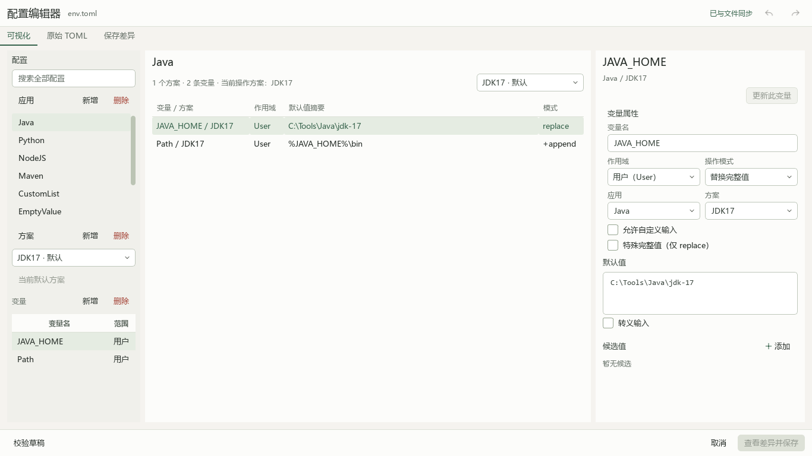
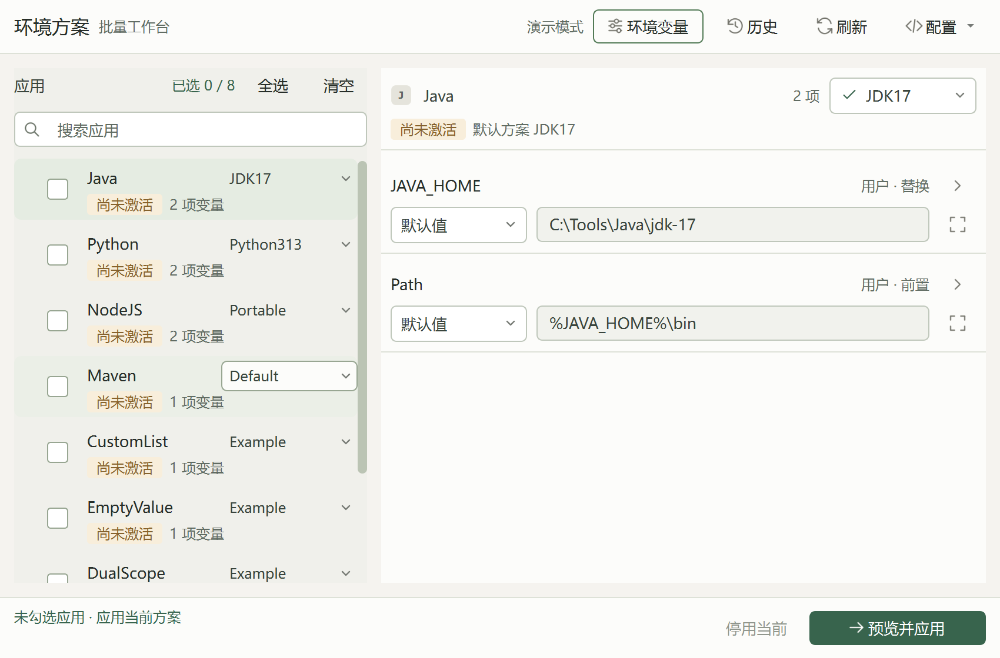

# Windows 环境变量方案管理器 V3

**按应用与方案管理环境变量；先预览、再审阅执行，保留历史与恢复记录。**

Windows 10 / 11 x64 · 紧凑浏览器界面 · 用户与系统变量 · TOML 配置编辑

[**下载 V3.0.0 正式版**](https://github.com/yuri368/windows-environment-manager-v2/releases/tag/v3.0.0) · [运行与使用说明](ui-v3/docs/product-v3/RUNNING.md) · [构建与 SHA256](ui-v3/docs/product-v3/BUILD.md) · [验收范围](ui-v3/docs/product-v3/RELEASE_READINESS_2026-10-19.md)

安装包包含 Python/Node 运行时，启动后打开本机浏览器界面。通常选择 **setup-user-x64.exe**；全机安装使用 **setup-machine-x64.exe**；便携使用 **windows-x64.zip**，解压后运行 `EnvManagerV3.exe`，保留整个目录。

- 按应用 → 方案 → 变量组织 TOML，可先命名，再补充属性；配置、未完成草稿与工作输入分别持久保存。
- 保留原文、重复项、空元素和稳定身份；整行上下拖动排序，普通行、幽灵行与前后对照同步反馈。
- 执行绑定已审阅的计划与环境快照；系统写入按需提权，保留历史及中断恢复记录。
- 安装 V3 不自动迁移 V2 数据；从界面导入 TOML，原始导入文件保持独立。V3 默认数据目录为 `%LOCALAPPDATA%\EnvManagerV3`。

隔离试用：`EnvManagerV3.exe --backend file --data-dir .\v3-isolated`，不会修改 Windows 环境。正式版未作代码签名；当前原生验收来自 Windows 11 差分系统，干净虚拟机、多用户、另一管理员凭据和真实断电实验的覆盖边界见验收记录。

下面保留 V2 使用说明与 [V2.0.1 下载入口](https://github.com/yuri368/windows-environment-manager-v2/releases/tag/v2.0.1)。V2 与 V3 的运行实现、安装目录和数据彼此独立。

# Windows 环境变量方案管理器 V2

**把环境变量按应用整理好。重装系统、切换 Windows 或更换软件版本时，少一点重复配置。**

Windows 10 / 11 · 中文图形界面 · 支持用户变量与系统变量 · 开源免费

[**⬇️ 下载 Windows 安装包**](https://github.com/yuri368/windows-environment-manager-v2/releases/tag/v2.0.1) · [查看使用方法](#三步上手) · [配置示例](env.example.toml) · [反馈问题](https://github.com/yuri368/windows-environment-manager-v2/issues)


主工作台采用 Compact Hybrid 紧凑布局，批量选择、方案准备和变量明细同时可见。配置编辑器将应用导航、配置总览与变量属性并排展示，保留原始 TOML、草稿撤销重做和保存差异确认。



## 这是什么？

如果你装过 Java、Python、Node.js 或其他需要环境变量的软件，大概遇到过这些麻烦：

- 重装 Windows 后，软件文件明明还在其他磁盘，却得重新设置 `JAVA_HOME`、`Path` 等变量。
- 电脑里有多个 JDK 或工具版本，每次切换都要打开系统设置，手动改路径。
- 装的软件越来越多，`Path` 越来越长。过段时间再看，已经分不清哪些路径属于哪个软件。
- 有多个 Windows 系统，想让同一套应用文件分别在不同系统里正常使用，却要重复配置。

**这个项目就是为这些场景做的。**

它不把环境变量当成一张孤零零的表，而是按照 **应用 → 方案 → 变量** 来整理。例如：

```text
Java
├─ JDK 17
│  ├─ JAVA_HOME
│  └─ Path
└─ JDK 21
   ├─ JAVA_HOME
   └─ Path

Python
└─ Python 3.13
   ├─ PYTHON_HOME
   └─ Path
```

平时选好应用和方案，需要时先预览，再确认写入 Windows。以后想换 Java 版本，找到 Java 的另一个方案即可，不必重新翻找每条变量。

> **说明：** 本工具负责环境变量，不负责安装软件、驱动或系统服务。重装系统后能否继续使用原来的软件，也取决于软件文件、路径和其他系统依赖是否仍然可用。

## 为什么选择它？

| 你遇到的问题 | 这个工具的做法 |
| --- | --- |
| 变量太多，记不住属于哪个软件 | **按应用管理**：Java 的归 Java，Python 的归 Python，查找、维护都更清楚 |
| 同一个软件有几个版本 | **一个应用，多套方案**：例如 Java 的 JDK 17 / JDK 21，可以按需选择 |
| 重装系统后要从头配置 | **保留并复用配置**：把配置文件备份好，在新系统中调整实际路径后重新应用 |
| 想一次恢复多个软件的环境 | **批量选择、统一预览**：不同应用可以分别选择方案，再一起执行 |
| 担心改坏 `Path` | **按列表处理路径**：可放到开头、末尾或确认排序，并处理本次涉及的重复项 |
| 不知道 Windows 现在符合哪套方案 | **全局匹配检测**：逐方案显示完全匹配、部分匹配、尚未配置及匹配数量，不依赖应用历史 |
| 想移除已经存在的方案配置 | **按实际匹配精细撤销**：可撤销单变量、单方案、应用全部方案或批量范围，列表变量精确到元素 |
| 不确定操作会改什么 | **先看结果再动手**：预览变更、检查冲突，确认后才写入 |
| 想回到之前的状态 | **提供历史和恢复检查**：仅在能够安全确认的情况下撤销或恢复，避免盲目覆盖其他修改 |

### 和其他环境变量工具有什么区别？

Windows 自带的编辑器、[PowerToys 环境变量工具](https://learn.microsoft.com/zh-cn/windows/powertoys/environment-variables)及其他第三方软件，都有自己的用途。PowerToys 也支持配置集，本项目并不是第一个能“切换环境变量”的工具。

**这里更强调的是：以应用为单位管理它需要的环境变量。**

你可以为每个应用分别准备多个方案，为一次操作选择多个应用，并把这些配置作为重装系统或多 Windows 环境下重新建立软件运行环境的基础。它适合喜欢保留应用文件、经常重装系统，以及需要维护多套开发工具的人。

## 三步上手

### 1. 下载并安装

前往 [Releases 下载页面](https://github.com/yuri368/windows-environment-manager-v2/releases/tag/v2.0.1)，选择 Windows x64 安装包（文件名以 `windows-x64-setup.exe` 结尾）。

双击安装，随后从桌面或开始菜单启动。**安装版已包含所需运行环境，不需要额外安装 Python 或 Qt，也不用打开命令行。**

支持 **Windows 10 1809 及更新版本、Windows 11（x64）**。正式运行时会按程序要求弹出 Windows 管理员权限确认窗口，确认后显示主界面。请使用 2.0.1 或更新版本，旧版 UAC 确认后不显示界面的问题已修复。

### 2. 配置你自己的应用

首次运行会准备一份示例配置。点击右上角 **“配置 → 可视化编辑”**，就可以添加应用、方案和变量，也可以修改现有记录。

例如，为 Java 建立 JDK 17、JDK 21 两个方案，分别填写 `JAVA_HOME` 和 `Path`。**记得把示例路径换成你电脑上真实存在的路径。**

不想用表单时，也可以通过 **“配置 → 编辑原始 TOML”** 直接编辑配置文件。两种编辑方式都支持先检查再保存。

### 3. 预览并应用

在主窗口勾选需要操作的应用，为它们选择方案，点击 **“预览所选应用”**。应用列表、方案下拉框和变量详情会同时显示 Windows 当前值与各方案的实际匹配情况；“已激活”只表示管理器最近一次成功操作，不会冒充实时匹配结果。

检查准备写入或调整的变量，确认没有问题后再执行。**只是选择方案、编辑配置或查看预览，都不会直接修改 Windows 环境变量。**

切换方案时，软件会识别 Windows 中已匹配的旧方案；出现多个候选或需要处理部分匹配方案时，由你明确选择。勾选多个应用也遵循同一流程，全部撤销与应用统一计算后一次确认，同一个 `Path` 等变量不会按应用重复写入。

需要移除配置时，可从变量行撤销单项，从底部撤销当前方案或当前应用全部方案；勾选多个应用后，“批量撤销”提供 **A：各自当前方案** 与 **B：所有方案** 两个明确范围。若内容还被未勾选应用的方案实际使用，软件会逐个变量或 `Path` 元素询问“保留/撤销”，无共享内容不会混入冲突窗口。

修改后，新打开的终端或程序通常更容易读取到更新后的环境；已经运行的程序可能需要重新启动。

## 适合哪些使用场景？

**💻 经常重装 Windows**

应用程序和开发工具保存在独立磁盘。重装系统后，只要软件本身仍可使用，就能参考之前保存的配置，把必要的环境变量重新建立起来，而不是靠记忆一项项填写。

**🔄 同时使用多个 Windows 系统**

同一套应用文件可能被多个 Windows 系统使用。把应用需要的变量整理成配置，各系统分别调整路径、预览并应用，降低反复配置的麻烦。**目前并不是自动跨系统同步工具。**

**🧰 使用多个开发工具或版本**

比如 Java 17 / 21、多个 Python 目录、Node.js、Maven 等。按应用组织，给同一应用准备不同方案，在需要时选择对应环境。

**📦 尽量减少新系统里的重复配置**

不必每次为了少数环境变量重新折腾一整套工具。环境变量仍然会写入 Windows，但你能更清楚地知道它们属于哪些应用、准备改哪些值。

## 主要功能

- **应用、方案、变量三级管理**：每个应用可以有多个方案，也能设定默认方案。
- **用户变量 + 系统变量**：清楚指定写入范围，不会把系统变量偷偷改写成用户变量。
- **更灵活地处理变量值**：可选默认值、上次成功应用时使用的值、预设候选值，以及允许时手动输入的值。
- **四种写入方式**：替换整个值、在列表开头添加、在列表末尾添加，或合并后自己确认顺序。
- **全部方案实时匹配**：自动扫描所有应用和方案，区分完全匹配、部分匹配、尚未配置与读取错误，并显示逐变量、逐元素详情。
- **五种精细撤销范围**：单变量、单方案、应用全部方案、批量 A 当前方案、批量 B 所有方案；可处理 Windows 中原本就存在的匹配配置。
- **逐元素共享保护**：普通变量按大小写敏感元素、特殊变量按完整值分别决定共享内容的保留/撤销，并列出全部相关应用与具体方案。
- **安全方案切换**：单应用及勾选批次均识别 Windows 中已匹配的旧方案，把旧方案撤销和新方案应用合并成一次净变更；歧义候选由用户明确选择。
- **批量预览和冲突检查**：多个应用的修改一起计算；有冲突时停止，而不是硬写。
- **历史与谨慎恢复**：记录执行信息；发现外部修改、共享变量等无法安全判断的情况，会阻止不可靠的恢复操作。
- **可视化配置编辑器**：新增、修改、删除应用与变量，支持搜索、撤销/重做、校验以及保存前查看差异。
- **快速打开 Windows 原生环境变量设置**：需要手动核对系统现状时，可以从主窗口直接进入。

## 界面预览

主界面以应用列表为入口，右侧查看当前方案和变量；支持同时勾选多个应用，统一预览。


缩小窗口后仍可使用主要操作。



## 重装系统后怎么恢复配置？

1. 在旧系统里备份个人配置文件 `env.toml`，并妥善保管它。
2. 在新系统安装本工具，把备份的配置放回个人配置位置。
3. 检查每个应用的真实路径是否变化；必要时在可视化编辑器中调整。
4. 选好应用与方案，**先预览，再确认应用**。

安装版默认配置位置：

```text
%LOCALAPPDATA%\EnvironmentManagerV2\config\env.toml
```

配置文件用于保存应用、方案和变量的**定义**。上次应用值、历史与恢复记录保存在本机另外的状态文件中，**不是复制 `env.toml` 就能把所有历史一起搬走**。

> ⚠️ **注意：** 配置或恢复操作不保证适用于所有软件，也不能保证撤销任意外部修改。请先检查目标路径；在应用涉及系统变量、`Path` 或多个程序共享的变量前，认真阅读预览内容。

## 想自己写配置？看这个简短例子

一般用户直接使用可视化编辑器就够了。喜欢手动管理配置的话，可以参考：

```toml
[Java]
default_option = "JDK17"

[Java.JDK17]
JAVA_HOME = { default_value = 'C:\Tools\Java\jdk-17', scope = "User", mode = "replace", editable = false }
Path = { default_value = '%JAVA_HOME%\bin', scope = "User", mode = "+append", editable = false }

[Java.JDK21]
JAVA_HOME = { default_value = 'C:\Tools\Java\jdk-21', scope = "User", mode = "replace", editable = false }
Path = { default_value = '%JAVA_HOME%\bin', scope = "User", mode = "+append", editable = false }
```

这里的 `replace` 表示替换变量值；`+append` 表示把指定列表项放到前面，不是覆盖整个 `Path`。更多写法见 [完整示例配置](env.example.toml) 和 [配置规范](AGENTS.md)。

普通值（包括 replace）均按分号拆分元素，修剪每段首尾 ASCII 空格和制表符，匹配区分大小写、忽略排列与重复。普通 replace 要求有且只有配置元素才完整匹配，但部分匹配也可撤销实际存在的配置元素。

需要原样保留分号及首尾空白的完整字符串时，在变量记录设置 `special = true`，仅允许 replace；同一作用域同名目标的所有方案必须统一特殊属性。

**高级设置**默认折叠，集中提供普通元素首尾空白、空元素和重复项整理，默认开启。整理只作用于明确执行的目标，结果进入预览与历史；关闭设置不改变检测规则。历史恢复和失败回滚原样恢复，不执行整理。详见 [vNext 技术规范](docs/core-semantics-vnext.md)。

## 可以搭配 Windows Link Manager 使用

我还开发了另一个项目：[**Windows Link Manager**](https://github.com/yuri368/windows-link-manager)。

- **Windows Link Manager**：按项目管理目录联接点、符号链接、硬链接，帮助恢复软件所需的目录或文件链接。
- **Windows 环境变量方案管理器 V2**：按应用管理环境变量，帮助恢复软件使用的路径和其他环境设置。

两者是**相互独立**的工具，不需要一起安装，也没有自动联动。组合使用时，可以分别处理“文件路径”和“环境变量”这两件事。

## 常见问题

**Q：点击保存配置，环境变量就会立即改变吗？**

不会。保存配置只是保存方案定义；需要在主窗口预览并确认执行，才会修改 Windows 环境变量。

**Q：系统变量能修改吗？**

支持用户变量和系统变量。程序正式运行会请求管理员权限；修改前仍要检查预览结果。

**Q：会自动扫描电脑里的软件吗？**

不会自动发现或安装软件。应用、方案和路径仍需要你自己配置；程序会自动读取你已配置目标对应的 Windows 环境变量，并判断每套方案当前是否匹配。

**Q：撤销方案等于恢复历史吗？**

不等于。方案撤销会根据当前 Windows 值移除仍然匹配的普通元素；撤销最后一个元素或匹配的唯一空值时删键，特殊值完整匹配时整键撤销，即使它们不是本工具写入的；历史恢复则把某次操作涉及的目标恢复到当时记录的原始快照。执行失败回滚又是另一套只用于恢复本次失败写入的机制，三者不会混用。

**Q：可以一键恢复所有旧状态吗？**

不能保证。工具会检查写入结果和恢复条件；变量被其他程序修改，或者多个已应用方案共享同一变量时，有些恢复操作会被阻止，以免造成更大的问题。

**Q：安装、升级会直接修改 Windows 环境变量吗？**

不会。安装和升级不会自动应用方案，也不会覆盖已有个人配置；只有你确认执行后才会修改变量。

## 开发者与更多文档

普通用户不需要阅读本节。想从源码运行、检查配置或了解具体实现，可以查看：

- [配置规范（AGENTS.md）](AGENTS.md)
- [TOML 配置编辑器说明](docs/toml-editor-architecture.md)
- [界面设计](docs/ui-design.md)
- [构建与发布说明](docs/github-release.md)

源码运行需要 Python 3.11 或更新版本。可在项目目录双击 `启动.cmd` 自动准备依赖；`启动.cmd -Check` 仅校验配置，`演示.cmd` 用于体验模拟界面（演示操作不会写入系统环境变量）。需要开发测试时可执行 `python -m unittest discover -s tests -v`。

## 许可证

本项目采用 **GPL-3.0-only** 开源许可证，详见 [LICENSE](LICENSE)。第三方软件与依赖的许可说明见 [THIRD_PARTY_NOTICES.md](THIRD_PARTY_NOTICES.md)。

如果发现问题或有改进建议，欢迎在 [Issues](https://github.com/yuri368/windows-environment-manager-v2/issues) 交流。
