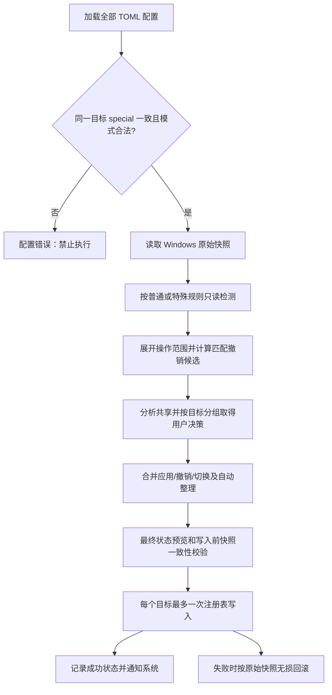

# Windows 环境变量方案管理器 V2
## 统一元素规则、特殊变量、匹配撤销与自动清理技术规范（vNext）

> **文档状态**：vNext 配置与行为规范，用于实施、审查和验收。
>
> **整理日期**：2026-10-12
>
> **适用项目**：[yuri368/windows-environment-manager-v2](https://github.com/yuri368/windows-environment-manager-v2)
> **范围**：统一元素、特殊值、匹配撤销、共享保护、自动整理及事务。实现和发布状态以对应版本的验收记录为准。

---

## 1. 目标与范围

系统保留以「应用 → 方案 → 环境变量」为单位的 TOML 配置、`User`/`System` 双作用域、四种应用模式及现有的选择与历史机制。在此基础上：

1. **普通环境变量**：统一按分号拆分成元素，按规范化后的**大小写敏感元素**匹配，检测不关注元素排列顺序；撤销以元素为单位。普通 `replace` 在应用时仍覆盖完整变量值，在检测时增加「有且只有配置元素」的完整匹配约束，但部分匹配仍可撤销实际存在的元素。
2. **特殊环境变量**：通过可选布尔字段 `special = true` 声明；整个值视为唯一不可分割的元素，不进行拆分、首尾空白修剪、去重或列表排序，只允许 `replace`；匹配使用完整原始字符串，撤销整个键。
3. **自动整理**：普通变量默认启用首尾空格/制表符处理、重复元素清理与无效空元素清理；只读检测不写注册表，执行应用、撤销或切换时仅整理操作涉及的目标，并进入最终预览、历史记录和回滚快照。
4. **共享保护与 UI**：普通变量按共享元素独立决策，特殊变量按完整值决策；共享冲突窗口按 `(scope, 变量名)` 分组，默认保留共享内容；最终执行前展示实际状态变化。

本次不引入「磁盘路径是否存在」检查，不自动删除暂时不可访问的路径；不改变应用默认值、上次成功应用值、当前选定值和 `choices` 相互独立的既有约束。

## 2. 核心术语与基础规则

| 概念 | 定义与规则 |
|---|---|
| 目标变量 | `(scope, name)`；`scope` 严格区分 `User` / `System`；**变量名称不区分大小写**，`Path` 与 `PATH` 在同一作用域归为同一目标。 |
| Windows 原始状态 | 含键是否存在、原始字符串、注册表类型（如 `REG_SZ` / `REG_EXPAND_SZ`）及作用域。**不存在**与**存在且 `""`**必须分开。 |
| 普通元素 | 将值按 `;` 拆分，去除每段首尾的 ASCII 空格 `U+0020` 和制表符 `U+0009` 后得到的内容；内部字符保持不变。 |
| 元素相等 | **区分大小写**，对归一化后的元素使用严格文本相等；`A` 不等于 `a`。不执行变量展开、路径解析、斜杠替换或文件系统大小写推断。 |
| 匹配归一化 | 只读计算使用统一的拆分、修剪、空元素处理与去重语义；不修改 Windows 原始字符串，与「自动整理写入开关」相互独立。 |
| 自动整理 | 在明确的应用、撤销、切换操作中，对本次目标执行实质性去空白、去空元素与去重处理；默认开启，相关设置收纳在高级设置中。 |
| 特殊值 | 配置标记为 `special = true` 的目标，整个原始字符串为唯一元素，按原文精确匹配与写入，不调用普通元素算法。 |

### 2.1 环境变量名称与值

- 名称不区分大小写；值及普通元素**区分大小写**。两者必须在代码中使用不同的比较函数，值比较不得调用变量名称的大小写折叠函数。
- 对 `REG_EXPAND_SZ` 中的 `%JAVA_HOME%` 等引用只比较**注册表原始文本**，不展开后再匹配。修改现有键尽可能保留原注册表类型；无损历史恢复同时恢复原类型。
- 所有模式的普通字符串值均采用相同的 `;` 元素语法；只有显式 `special = true` 例外。

## 3. TOML 数据规范

### 3.1 向后兼容的可选字段 `special`

```toml
[Java.JDK8]
Path = { default_value = '%JAVA_HOME%\bin;%JAVA_HOME%\lib', scope = "User", mode = "+append", editable = false }
JAVA_HOME = { default_value = 'C:\Java\jdk8', scope = "User", mode = "replace", editable = true }

[Demo.Default]
SPECIAL_VALUE = { default_value = '  A;B;C  ', scope = "User", mode = "replace", editable = true, special = true, choices = [{ label = "原值", value = '  A;B;C  ' }, { label = "备用值", value = ' X;Y ' }] }
```

- `special` 类型严格为布尔值，缺省为 `false`；它与 `choices` 一样是变量记录的可选字段，**不是**候选值字段。
- `special = true` 只允许 `mode = "replace"`；`special = true` 配合任意追加模式属于配置错误。
- `special = true` 不改变 `default_value`、`choices[].value`、上次应用值或当前选定值的字符串类型；自由编辑与候选切换也沿用所属变量的同一 `special` 属性。
- 特殊值中的分号、首尾空格、制表符、重复字符及原样为空的字符串都是内容的一部分，不进行普通元素处理。仍需执行 NUL、长度等基础合法性校验。
- **全配置一致性约束**：遍历**所有应用、所有方案、User/System 的每条实际变量记录**，按归一化目标 `(scope, 不区分大小写的 name)` 分组。同一目标的全部定义，`special` 必须一致（显式未填按 `false`）。有冲突则配置校验失败，禁止加载为可执行配置。User 与 System 同名变量互不约束。
- 在此约束下，不存在「同一目标的一个方案把值视为特殊整体、另一个方案把它视为普通分号列表」的合法情况。
- TOML 正常选择或执行应用不修改原始配置；配置编辑器创建、复制和修改变量时也必须遵守一致性校验。

## 4. 普通元素解析、清理和去重

### 4.1 元素解析

1. 用 `;` 分隔原始字符串，不做引号转义或分号转义。
2. 对各段移除首尾空格和制表符，内部空格、制表符及其他字符原样保留。
3. 清理多余的空段、全空格段、全制表符段。
4. 按**大小写敏感**的元素内容去重；匹配时将重复项视为同一有效元素。
5. 匹配忽略元素排列顺序；执行中的 `+append`、`-append`、`append`、`replace` 仍分别遵循原有应用排序语义。

**示例**：原始 `A; B ;A;;\t;C;` 的默认整理结果为 `A;B;C`。`A` 与 `a` 是不同元素，不能去重合并。

### 4.2 唯一空值与不存在

- 原始变量**存在且值恰好为 `""`**是一种合法的空值状态；清理时允许保留这唯一空值，不把它当作需要删除的「多余空元素」。
- 多元素列表中的无效空元素可以删除；只有分隔符、空格和制表符的普通值在清理后没有非空元素时，可表示为存在且值为 `""`（非撤销语境）。
- **撤销最后一个非空元素**后，不保留 `""`，而是**删除该环境变量键**。
- 空选定值不得因为「所需元素集合为空」而匹配所有非空 Windows 值。对于直接选定的 `""`，完全匹配要求目标键存在且 Windows 原始值为 `""`；目标键不存在为缺失，非空为值不匹配。
- **主动撤销唯一空值**：如果本次选定值为 `""`，且 Windows 目标键存在、原始值恰好为 `""`，则视为可撤销的已匹配空值，**删除变量键**。这与仅执行自动清理时保留唯一空值不同。

### 4.3 写入整理时机与顺序优先级

- 只读全局检测、只读预览不写 Windows；仅实际应用、撤销、切换方案时，在所涉及的目标上合成一次最终状态并按设置整理。不进行无关目标的全系统清理。
- 默认启用首尾空白整理、空元素清理、去重；在**高级设置**中集中管理，主界面不显示大量零碎开关。
- 关闭「写入自动整理」不改变只读匹配的归一化准则；普通变量的撤销仍按有效匹配元素执行。对于撤销后的剩余内容，保留**未命中元素的原始文本、已有空元素及相对顺序**，不额外修剪、去重或清除空段；只去掉本次实际撤销的元素，并以 `;` 连接剩余原始元素切片。不得因删除一个元素而凭空生成额外空段；也不得借拼接之机清除未命中的既有空段。例如原值 `" A ;B;; C "` 撤销 `B`、自动整理关闭，则结果为 `" A ;; C "`。无论整理开关如何，撤销后若不存在任何非空有效元素，则删除变量键。
- 普通清理保留重复项中原有顺序靠前的一份；`+append` 最终优先前端副本，`-append` 最终优先末端副本，`append` 服从用户确认后的排列，`replace` 以配置目标顺序为准并保留首个等值项。
- 自动整理本身允许清除涉及目标上其他应用留下的无效空项与多余重复副本，**无需因普通无效格式清理而额外弹窗**；但合法共享元素的删除仍走共享冲突判定。至少保留用户选择保留的共享元素的一份有效副本。
- 自动整理属于实质变更，写入计划和最终预览必须展示前后值及清理结果；保存完整原始状态用于事务失败回滚、历史记录和恢复。
- **历史恢复和失败回滚不执行自动整理**：精确恢复原始存在状态、文本、顺序、重复项、空项与注册表类型。

## 5. 四种应用模式的匹配与应用

| 模式 | 应用操作（写入） | 普通变量「完全匹配」判定 | 撤销候选 |
|---|---|---|---|
| `replace` | 用当前选定值的目标结果替换**整个键的值**，并按写入整理设置处理 | Windows 有效元素集合与配置有效元素集合**完全相等**；不得存在配置外额外元素，忽略顺序和重复项 | **全部实际存在的配置元素**，包括部分匹配的元素 |
| `+append` | 将目标元素按既有规则安排在前端 | Windows 包含所有配置有效元素即可，多余元素不影响匹配 | 实际匹配的配置元素 |
| `-append` | 将目标元素按既有规则安排在末端 | 同上 | 同上 |
| `append` | 经用户确认排序后合成目标值 | 同上，检测忽略顺序 | 实际匹配的配置元素 |

**普通 `replace` 与特殊 `replace` 不得混淆**：普通 `replace` 使用元素集合完整匹配及部分元素撤销；特殊 `replace` 保留完整原始字符串匹配和整键撤销。

### 5.1 普通 `replace` 示例

配置 `A;B`，Windows 为：

| Windows 原始值 | 普通 `replace` 完整匹配 | 已匹配元素 | 额外元素 |
|---|---|---|---|
| `A;B` | 是 | `A`、`B` | 无 |
| `B;A` | 是 | `A`、`B` | 无 |
| ` A ; B ` | 是 | `A`、`B` | 无 |
| `A;A;B` | 是 | `A`、`B` | 无 |
| `BASE;A;B` | 否 | `A`、`B` | `BASE` |
| `A;C` | 否 | `A` | `C` |
| `a;b` | 否 | 无 | `a`、`b` |
| 键不存在 | 否，缺失 | 无 | 无 |

`replace=A;B`、Windows=`A;C` 时，撤销已匹配的 `A` 后为 `C`。`replace=A;B`、Windows=`BASE;A;B` 时，撤销已匹配的 `A`、`B` 后为 `BASE`；`BASE` 不属于撤销目标。`replace=A;B`、Windows=`B;A` 时，**检测为完全匹配**，但主动应用 `replace` 仍能按配置与清理规则写回指定顺序。

### 5.2 匹配状态的汇总

- 每个变量记录保存匹配元素、缺失元素、**额外元素**、重复计数、是否完整匹配、键存在状态和检测错误；检测错误与业务状态分开。
- 方案 `M/N`：`M` 是完整匹配的变量记录数，`N` 是该方案变量记录总数。
- 方案完全匹配：所有记录完整匹配；尚未配置：所涉目标键在相应作用域全都不存在；其他目标键已存在但未全部完整匹配的情形为部分匹配。例如 1 条普通 `replace=A;B`、Windows=`A;C`，方案显示 `0/1 部分匹配`，并允许撤销已匹配的 `A`。
- `special=true` 变量不存在为缺失，Windows 原始值与选定值完全相同时匹配，否则为值不匹配；没有「内部元素部分匹配」。

## 6. 特殊变量 `special=true`

| 行为 | 规定 |
|---|---|
| 元素结构 | 整个选定值/Windows 原始字符串视为一个不可拆分元素。 |
| 分号 | 只是字符串内容，不作为分隔符。 |
| 空白 | 首尾空格、制表符及其他字符都原样保存和匹配。 |
| 去重、清理、列表排序 | **不参与**普通整理或排序。 |
| 大小写 | 值按原始字符串精确匹配，**区分大小写**。 |
| 应用 | 仅允许 `replace`，用完整选定字符串覆盖目标键。 |
| 匹配 | 键存在且原始字符串逐字符等于当前选定值。 |
| 撤销 | 完全匹配才有整键撤销候选；撤销时删除该键；不允许拆分后只删其中的子串。 |
| 共享 | 所有同目标配置都必须为特殊变量；其他应用的匹配特殊方案可能共享**完整值**，撤销前显示整键共享冲突并允许保留/撤销。 |

举例：`special=true`、`default_value='  A;B  '` 只匹配 Windows 原始值恰好为 `␠␠A;B␠␠` 的情况，不能匹配 `A;B`，也不能单独撤销 `A`。

## 7. 撤销范围与共享冲突

### 7.1 保留既有五种撤销范围

1. 单条变量记录；2. 单个方案；3. 单应用全部方案；4. 勾选应用的各自当前方案；5. 勾选应用的全部方案。

对单应用撤销和两个批量撤销类型，其他未选择应用的**全部方案**属于共享保护检查范围，不仅检查软件自己的历史激活记录。用户手动配置但实际匹配的 Windows 元素同样可检测和撤销。

### 7.2 普通变量：始终元素级决策

- 撤销引擎只产生**实际匹配**的目标元素候选。来自多个撤销来源的同一元素合并为一个决策对象，保留来源信息。
- 对其他受保护应用实际依赖的同一元素产生共享冲突，**默认保留**；用户可对每个共享元素独立选择保留或撤销。「全部保留 / 全部撤销」只批量作用于共享项，不修改未共享项的正常撤销规则。
- 保护方的普通 `replace` 即使尚未完整匹配，也应保护其**当前确实匹配的元素**：例如保护方配置 `A;B`、Windows 为 `A;C`，另一应用撤销 `A` 仍须提示共享冲突；保护范围不包含不存在的 `B`。
- `replace` 的配置集合**没有完整匹配**不妨碍实际存在的配置元素成为撤销候选；配置外元素不成为撤销候选。
- **普通** `replace` 统一产生元素撤销候选，并对共享元素独立决定保留或撤销；最后一个有效元素被撤销时删除键。
- 对用户选择保留的共享元素，不能因为后续组合、去重或整理把其最后一份有效副本删除。
- **空值共享保护**不以普通非空元素表示：当受保护方案的选定值为 `""` 且 Windows 目标键存在、原始值恰好为 `""` 时，该方案依赖的是这个目标键的**存在且为空**状态。其他操作若拟删除该键或将它改为非空值，须识别状态冲突、默认保留并告知受影响方案。不能因为空值没有非空元素就绕过共享检查。

### 7.3 特殊变量：整值/整键决策

- 特殊值不可拆分，匹配才产生一个完整键的撤销候选；多个应用依赖同一实际匹配的完整值时，默认保留，并显示全部受影响的应用/方案。
- `special` 一致性约束先于冲突分析，因此不存在同目标「特殊完整值」与「普通元素撤销」相互争夺的合法配置。
- 即便设置默认清理开启，特殊目标也**不**进行普通列表清理。

### 7.4 冲突 UI 结构

```text
共享冲突处理
├─ User / Path                       （普通目标）
│  ├─ 元素 A  · 共享：App X / 方案 1  [保留 | 撤销]
│  └─ 元素 B  · 共享：App Y / 方案 2  [保留 | 撤销]
├─ System / SPECIAL_VALUE            （特殊目标）
│  └─ 完整值 '  A;B  ' · 共享：App Z [保留完整值 | 撤销整键]
└─ [全部保留共享项] [全部撤销共享项]

最终预览：按目标展示 Windows 原始状态 → 最终状态，
         区分正常撤销、保留的共享项、自动清理与跳过项。
```

组内共享对象独立决策，不再为同一个 `(scope, name)` 的每个元素堆叠一整张大卡片。无共享的正常撤销目标无需进入共享冲突弹窗，但必须进入最终预览。

## 8. 切换、事务、预览与历史



- 方案切换遵循「旧方案按新规则计算可撤销元素 → 新方案按原模式计算应用 → 合成最终一次写入」，对公共元素、共享保护、顺序与去重进行统一裁决；不能简单地先物理删再物理加。
- **批量同目标应用冲突**沿用既有安全策略：多个普通 `replace` 的配置即使检测时具有相同元素集合，若要写入的实际字符串/最终目标排列不同（例如 `A;B` 与 `B;A`），也不能因集合相等便自动任选一个写入顺序；应报告批量写入冲突，要求消除歧义。`replace` 与其他追加模式同批写入同一目标时，同样不得擅自合成与既有约束矛盾的结果。
- 对同一注册表目标，一次事务最多执行一次综合写入；执行前冻结选定方案和值、原始注册表状态与用户共享决策，写入前重新核对快照，失败按原始状态回滚。
- 只读检测**不**改变 TOML、选择状态、上次成功应用值、历史或注册表；只有成功执行方案才更新原有约定的上次成功选定值。
- 存在性、空字符串、实际元素、User/System 作用域与注册表类型均属于预览、比较与回滚的组成部分。
- System 作用域和系统关键变量的删除必须在最终预览中明确警告；不要让清理引擎绕过权限和确认流程。

## 9. 高级设置与默认值

| 设置项 | 默认 | 作用范围 |
|---|---|---|
| 普通元素首尾空格与制表符清理 | 开启 | 普通值写入整理；**检测始终按统一修剪规则** |
| 清理无效空元素 | 开启 | 普通值写入整理；检测始终按统一有效元素规则 |
| 普通元素大小写敏感去重 | 开启 | 普通值写入整理；检测始终按去重后的有效元素集合判断 |
| 特殊变量整理 | 不适用 | `special=true` 永远不进入普通整理引擎 |

这些选项默认隐藏于高级设置，不在主列表逐个展示。设置关闭后的应用、撤销与切换必须有一致、可测试的定义；不允许通过关闭清理开关改变元素相等性或匹配状态。所有写入改动仍要进入最终预览与回滚快照。

## 10. 核心验收测试矩阵

| 编号 | 测试输入/场景 | 预期结果 |
|---|---|---|
| T01 | 同一 User 目标 `Path` 与 `PATH` | 视为同一目标；同名 System 目标独立。 |
| T02 | 普通选定 `A`，Windows 为 `a` | 不匹配；撤销不能误删 `a`。 |
| T03 | 普通选定 `A;B`，Windows 为 `B; A ` | 匹配 `A`、`B`，忽略顺序和无效首尾空格。 |
| T04 | 普通 `replace=A;B`，Windows=`B;A` | 完整匹配；应用时仍按配置顺序形成目标值。 |
| T05 | 普通 `replace=A;B`，Windows=`BASE;A;B` | 不完全匹配；A、B 为撤销候选，BASE 保留。 |
| T06 | 普通 `replace=A;B`，Windows=`A;C` | 不完全匹配；只撤销 A，结果 C。 |
| T07 | 普通选定 `A;B`，Windows=`a;b` | 无任何匹配元素。 |
| T08 | 普通 Windows=`A;A; B ;;\t;C;`，执行写入整理 | 去重、去空项、去无效首尾空白后为 `A;B;C`。 |
| T09 | 普通 Windows=`A;a;A` | 去重后 `A;a`，大小写不同分别保留。 |
| T10 | 普通只剩 `A`，撤销 A | **删除键**而非写成空字符串。 |
| T11 | 普通变量当前原始值恰好 `""`，只执行清理 | 仍可保持已存在且值为 `""`。 |
| T12 | 三种追加模式选定 `""`，Windows=`A;B` / `;` | 不能判断为完全匹配。 |
| T13 | 三种追加模式选定 `""`，Windows 存在且原始值 `""` | 完全匹配；键不存在为缺失。 |
| T14 | `special=true`、值 `  A;B  ` | 只匹配相同原始文本；保留分号、大小写、首尾空格。 |
| T15 | `special=true` 配 `+append` | 配置校验失败。 |
| T16 | 两个应用同一 User/Path，分别 `special=true` 和默认 false | 整份配置校验失败；不得静默选边。 |
| T17 | User/Path 为特殊，System/Path 为普通 | 合法，作用域隔离。 |
| T18 | 两个匹配的特殊方案共享完整值，撤销其中一个 | 出现整键共享冲突，默认保留，可明确选择撤销。 |
| T19 | 普通 A 与 B 共享同一元素，另有无效空项/重复项 | 元素冲突由用户决定；自动整理可清理无效副本，但不能丢掉选择保留的共享元素。 |
| T20 | 同一变量多个共享元素 | UI 按变量分一组，组内逐元素独立选择。 |
| T21 | 只读检测、全局刷新 | 不写注册表、配置、历史或选择状态。 |
| T22 | 执行中失败后回滚 | 逐字恢复原始值、顺序、空项、重复副本、注册表类型和存在状态。 |
| T23 | 历史恢复 | 不执行任何默认自动清理。 |
| T24 | 关闭自动写入整理 | 匹配结果不因设置变化而改变。 |
| T25 | 用户/系统关键变量将删除 | 最终预览显示删除风险与权限要求。 |
| T26 | 已存在唯一空值 `""`，当前选定值亦为 `""`，主动执行撤销 | 删除目标变量键；与只执行清理时保留唯一空值区分。 |
| T27 | Windows=`" A ;B;; C "`，撤销 `B`，自动整理关闭 | 结果严格为 `" A ;; C "`；匹配规则不变、剩余原始元素不额外清理。 |
| T28 | Windows=`"A;;"`，撤销 `A`，自动整理关闭 | 因已无剩余非空有效元素，删除键。 |
| T29 | 受保护普通 `replace=A;B`，Windows=`A;C`；另一应用撤销 `A` | 即使该 `replace` 仅部分匹配，仍对现存 `A` 触发共享冲突，默认保留。 |
| T30 | 受保护方案选定 `""` 且 Windows 键存在且为空；其他操作拟删除该键或写成非空 | 识别共享的空值状态依赖，默认保留，并展示受影响方案。 |
| T31 | 同批两个普通 `replace` 写入同一目标，期望分别为 `A;B` 和 `B;A` | 虽可对同一 Windows 值检测为集合匹配，但批量写入顺序存在歧义，报告冲突、不擅自任选其一。 |

测试应覆盖单变量、单方案、单应用全部方案、批量当前方案、批量全部方案、切换与撤销前的快照变化，尤其要覆盖相同目标的跨应用组合及配置编辑后重新校验。

## 11. 空值撤销与关闭整理的执行规则

本节集中说明与第 4 节一致的具体执行语义：

1. **唯一空值**：自动清理时可保留存在且恰好为 `""` 的变量；但用户主动撤销一条与此空值实际匹配的配置时，应删除对应变量键。空输入绝不因为缺少必需元素就匹配非空 Windows 值。
2. **关闭自动整理**：匹配阶段仍执行统一逻辑归一化；撤销阶段按该匹配结果定位元素，但仅从原始列表切片中去掉本次命中的元素。未命中切片维持原始字符（包括首尾空白）、相对顺序及原有空元素，再以 `;` 连接。不会人为增加空元素，也不会附带清理原有空元素、重复项或空白。
3. **删除优先于保留空值**：撤销后如果没有非空有效元素，则删除目标键，包括自动整理关闭的情况。
4. **典型示例**：`" A ;B;; C "`，撤销 `B`，整理关闭 → `" A ;; C "`；`"A;;"`，撤销 `A` → 删除键。

上述规则在 T26～T28 中设置回归用例；共享与批量同目标歧义另在 T29～T31 中验证。

## 12. 模块边界与实施验收顺序

> 配置与纯逻辑层负责定义规则，Service 负责冻结、预览和事务协调，UI 只展示结果并收集明确决策。自动化测试使用隔离的 MemoryStore，不修改宿主环境变量。

| 模块 | 职责与要求 |
|---|---|
| `config.py` / `models.py` | 支持 `special` 可选布尔字段；跨全部方案按 target 检查一致性；追加模式与 special 不兼容。 |
| `engine.py` | 普通元素解析、大小写敏感去重、空项与空白处理、执行期整理；特殊值按原文替换；维持原四种应用模式的顺序。 |
| `matching.py` / `detection.py` | 普通 `replace` 的元素集合完整匹配与部分匹配；特殊值原文匹配；空输入非真空问题；额外元素和计数。 |
| `removal.py` | 普通 `replace` 也改元素级撤销；撤销至空删键；特殊值整键撤销；统一合成候选。 |
| `sharing.py` | 全配置一致的特殊目标整键共享；普通共享元素保护，去重后保留至少一份。 |
| `switching.py` / `service.py` | 新规则下的旧方案撤销与新方案应用合成；冻结快照；最终写入、预览与回滚一致。 |
| `selection.py` / 配置编辑器 | 候选值和自定义输入遵循变量的特殊属性；配置编辑器校验特殊目标跨方案一致性。 |
| `ui.py` | 按 `(scope, name)` 分组的冲突处理 UI；普通逐元素、特殊整键；高级设置默认折叠。 |
| `tests/` | 契约测试与本规范验收矩阵保持一致；报告哪些测试实际运行、哪些仅提交未运行。 |

**实施与验收顺序**：① 配置模型与跨方案校验 → ② 统一纯元素解析/清理 → ③ 匹配检测与空值 → ④ 撤销及共享分析 → ⑤ 切换/批量操作/事务 → ⑥ UI 与配置编辑 → ⑦ 回归测试和人工验收。

### 完成标准

- 本文所有定义的行为均有通过的自动化测试与关键 UI 验收案例；空值撤销与关闭整理按第 11 节实施，并通过相应测试。
- 保留 User/System 隔离、注册表原始值/类型、方案选择与已保存值独立性、只读检测、执行前校验、一次目标一次写入与完整回滚。
- AGENTS.md、用户配置示例、Issue #2 和验收记录遵循同一配置与行为规范；测试报告明确说明实际运行结果和未验证的环境。
