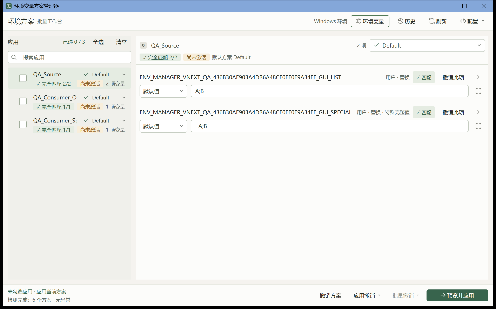
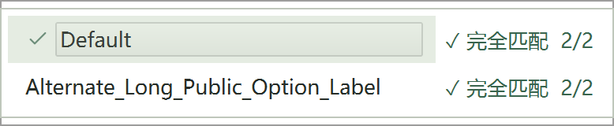
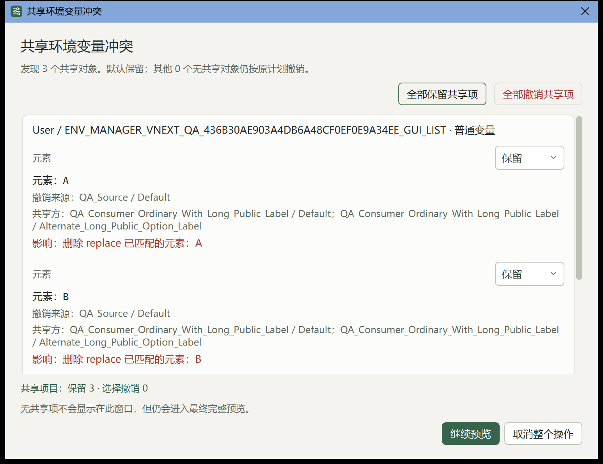
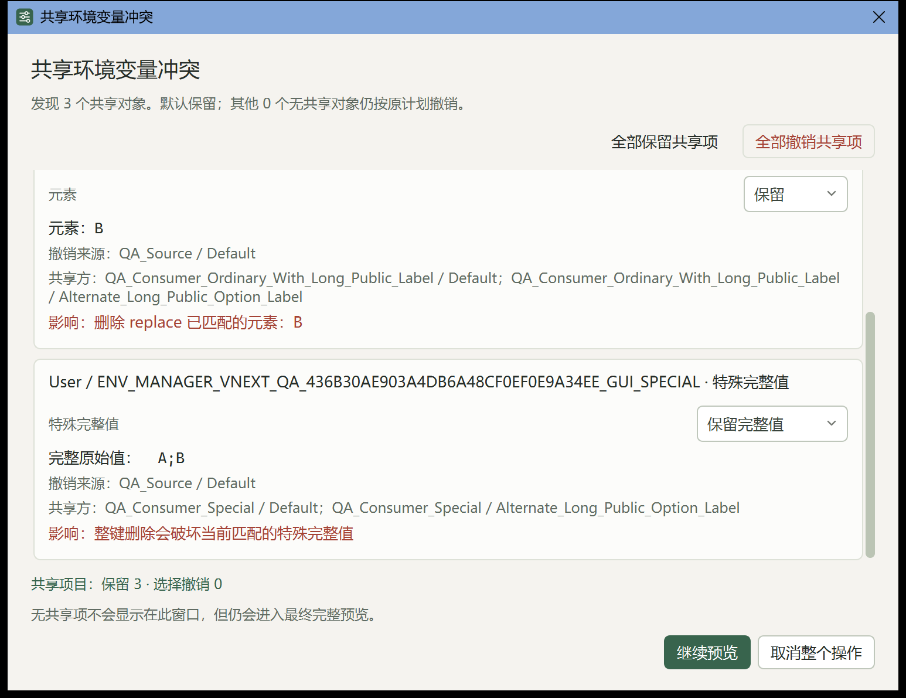

# Issue #5：兼容撤销、CI 与高 DPI 验收

## 实现范围

`plan_deactivate(app, decisions=None)` 保留兼容调用方式，激活记录只用来确定方案；当前选定值与 Windows 实际状态通过新版 `prepare_remove()` / `finalize_remove()` 计算撤销。其他未选择应用的全部方案参与共享保护，默认保留共享元素、特殊完整值和空状态依赖。调用方可使用 atom-id 明确选择撤销，返回计划仍须预览，执行前核对冻结输入。

服务层不再保留按历史前值回退的 `_undo()` / `_shared_apps()` 路径。未绑定的 UI `_deactivate()` 复用现有方案撤销流程。独立的 `plan_restore()` 继续精确恢复原始存在状态、文本和注册表类型，不执行整理。

窗口首次显示后根据当前屏幕工作区及原生边框约束初始尺寸，保留桌面边缘余量；较大的工作区保留默认客户区大小。只在首次显示时处理，不强制改变之后用户调整的窗口大小。修复版本为 2.1.1。

配置编辑器候选表按真实字体尺寸计算紧凑表头和可读行高，独立限制视口高度；更多候选或大字号使用逐像素滚动。两项新回归模拟平台表头提示差异并检查实际字体、大字号和末行滚动，既有紧凑高度断言保持不变。Windows 系统设置接口的跨平台 mock 明确提供原生创建标志，继续验证 shell、文件路径与标准流，不依赖 Linux 标准库包含 Windows 常量。

启动器回归按文件与目录的实际身份核对可执行文件和工作目录，兼容 Windows 同一位置的长路径及 8.3 短路径表示。参数数量、flags、绝对路径、中文/空格/引号名称和末尾反斜杠仍严格检查；本机正常路径及真实短路径别名两次各 7 项测试通过。生产启动器行为未改变。

## 回归测试

在修复前的 `3a79721` 实现上，新增回归实测失败：Java 应用 `A` 后，Scala 未激活、当前浏览另一个方案，但其 Shared 方案实际依赖 `A`；旧停用结果为 `BASE`，测试要求保留 `A;BASE`。修复后此用例通过。

新增 16 项兼容服务回归和 1 项 UI 回归，覆盖未激活共享方的全部方案、默认保留与明确撤销、普通 replace 部分匹配、special 完整值、空状态、大小写、关闭整理、外部状态/来源变化、失败回滚与独立历史恢复。相关 199 项测试通过。新增 3 项工作区回归验证 200% 缩放等价工作区、非零屏幕原点、原生边框、底部按钮和后续用户调整。

新增 GUI 人工验收纯边界测试只使用 MemoryStore、mock 和内置 UIA 程序集检查，不执行 UAC、宿主环境变量写入或真实窗口操作。

本机完整发现测试实际执行 531 项，667.304 秒，`OK`，没有跳过；该次运行后新增的四项下拉工具边界测试与既有两套验收工具测试联跑，共 21 项通过。启动器 7 项测试在正常路径及真实 8.3 别名下分别通过，候选配置编辑器完整模块 47 项通过。

完整测试命令为：

```text
python -m unittest discover -s tests -v
```

## 双平台持续集成

新增 `.github/workflows/tests.yml`，在 Ubuntu/Windows Python 3.13 上创建项目 `.venv`，按固定 requirements 安装依赖，执行完整发现命令。Qt GUI 使用 offscreen；原生窗口可见性测试单独使用 Windows 平台进程。工作流上传完整日志、退出码和环境信息，在 Job summary 中逐条列出平台跳过原因。静态 actionlint 校验通过，远端是否通过以对应提交的实际 Actions 结果为准。

注册表自动化测试仅使用 `HKCU/Software/EnvironmentManagerV2Tests/<UUID>`，两个逻辑作用域均映射该隔离子树。真实 Environment/HKLM、UAC、安装与物理高 DPI 测试仍属于独立人工验收。详见 [CI 文档](ci.md)。

最终代码提交 `07a08b0a9bb36ac1882f40bb39c93e8da0223a78` 的 [PR 双平台 Actions 运行](https://github.com/yuri368/windows-environment-manager-v2/actions/runs/38198841119) 实际成功，同提交的 push 运行也成功：

| 平台 / Python | 测试总数 | 通过 | 跳过 | 失败或错误 | unittest 耗时 |
|---|---:|---:|---:|---:|---:|
| [Windows / 3.13](https://github.com/yuri368/windows-environment-manager-v2/actions/runs/38198841119/job/114647467112) | 535 | 535 | 0 | 0 | 801.010 秒 |
| [Ubuntu / 3.13](https://github.com/yuri368/windows-environment-manager-v2/actions/runs/38198841119/job/114647467315) | 535 | 518 | 17 | 0 | 145.797 秒 |

Ubuntu 的 17 项跳过分别为：原生启动窗口标志 1 项、Windows PowerShell 启动器 7 项、内置 UIA 程序集只读检查 1 项、Windows ctypes 权限边界 5 项、隔离注册表适配 3 项。这些项目在 Windows runner 均实际执行并通过。每条原始跳过原因、完整日志和运行环境见对应 Job summary 与 `test-results-*` artifact。

## 正式安装版高 DPI 验收方法

`tools/manual_windows_gui_acceptance.py` 要求人工同意管理员 UAC、绝对安装 EXE 路径、完整 GUID 和新建或空的验收目录。它仅准备两个 GUID 命名的 User 临时变量，使用独立配置/状态目录等待非管理员控制器启动安装版自身 UAC，不调用演示模式。

工具限定安装路径、创建时间、提权令牌、PID 与 HWND，拍摄物理像素完整窗口并记录 DPI/工作区。UI Automation 只展开/收起方案下拉，打开共享冲突预览、检查分组/默认保留及内容可见性或滚动，随后取消整个操作。它不确认应用或撤销。结束时核对临时值、历史和激活状态没有被 GUI 预览改写，再仅清理本工具确认仍持有的临时变量。

方案下拉每次重新读取已验证主窗口的 UIA 树，确认唯一展开的方案选择器和对应列表；再读取同 HWND 的 `QComboBoxPrivateContainer`，核对进程、提权令牌、窗口身份、可见性和物理客户区。容器、内部列表和两条选项分别校验边界，使用整个原生窗口尺寸拍摄。各项目独立报告；下拉不完整时，确认安全折叠后仍可验收共享对话框，折叠无法确认则跳过预览。

共享弹窗只操作自身 UIA 子树中的唯一纵向 QScrollBar，通过 RangeValuePattern 滚到最大值后恢复最小值。记录实际滚动值及稳定的内容 RuntimeId；初始、底部、恢复顶部三次截图结合 viewport 边界，验证全部内容逐次可见。调用成功但位置未变、内容身份改变或可见覆盖不完整仍为未通过。本次增补五项工具回归，相关两套验收工具测试共 26 项通过，包括真实 PowerShell Parser 和内置 UIA 程序集只读校验。

若控件未暴露所需 UIA 能力或任何步骤未完成，结果明确标为 partial/failed；不以源码或演示截图替代安装版正式窗口证据。个人配置、路径和私密状态不进入公开截图。

## 2.1.1 正式安装版实际结果

2026-10-12 在 Windows 11（build 26100）、2560×1600 屏幕、192 DPI / 200% 缩放下运行正式安装版。安装前备份现有安装与个人数据，安装退出码为 0，注册版本为 2.1.1，个人文件指纹保持不变；安装目录、不含 Python 的 PATH 下执行配置检查和独立演示启动均通过。

非管理员控制器启动安装版自身的 UAC，经人工确认后，核实真实提权令牌、安装 EXE、PID、HWND 与 `IsWindowVisible=true`。正式主窗口完整截图为 2406×1501 物理像素，窗口矩形 `(77,16)–(2483,1517)` 位于 2560×1520 工作区内，底部撤销与应用按钮可见。



正式安装版完整 GUI 补验结果为 `passed`，主窗口、方案下拉和共享冲突弹窗三项均通过。独立下拉截图为 778×160 物理像素，两条完整方案标签及状态均可见；窗口矩形 `(1782,206)–(2560,366)` 位于工作区内。容器、客户区、内部列表与两条选项的边界分别通过验证。



共享弹窗为 1546×1191 物理像素，矩形 `(487,148)–(2033,1339)` 位于工作区内。按两个 Windows 目标分组，三项共享决定默认保留，取消和继续预览按钮可见。实际纵向滚动值为 `0 → 186 → 0`，17 个内容对象在顶部/底部/恢复顶部视口中完整覆盖，文字及特殊完整值说明可读。





验收只展开、收起、滚动并取消预览，没有确认应用或撤销。正式进程与管理员验收工具的退出码均为 0；两个临时 User 目标无残留，预览没有改写注册表、已提交历史、激活状态或个人文件。正式 EXE SHA-256 为 `261aff50f1da05e228a0d51b6b3c8491ad6b9812e6de1bc2a2a71d524eb382f4`，与已验证安装构建一致。

本地完整记录位于被忽略的 `artifacts/issue5-ui-retest4-2.1.1-20261012/` 和 `artifacts/issue5-delivery-final-2.1.1/`。公开截图只包含专用 QA 名称和值，不包含个人配置或路径。CI 不能替代物理屏幕和安装版人工验证。
