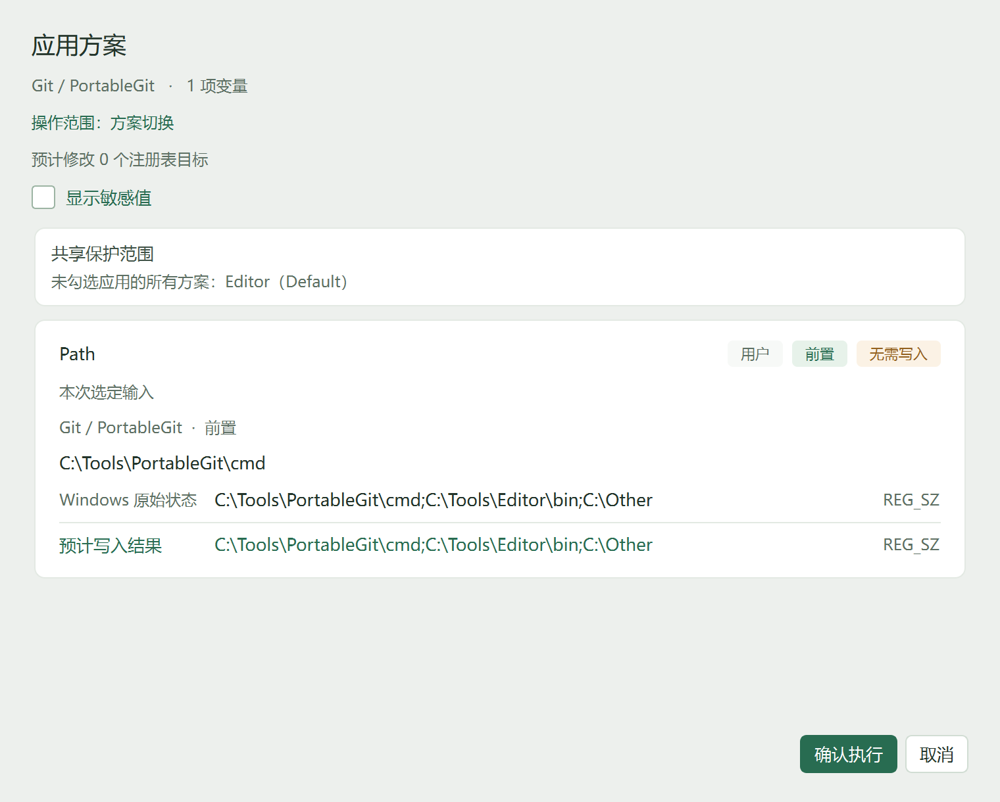
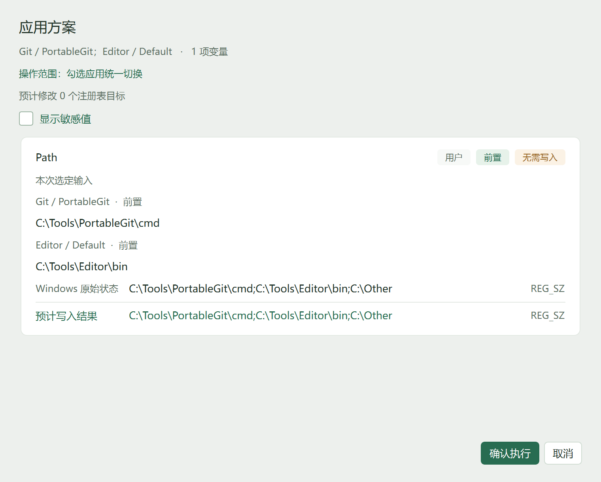
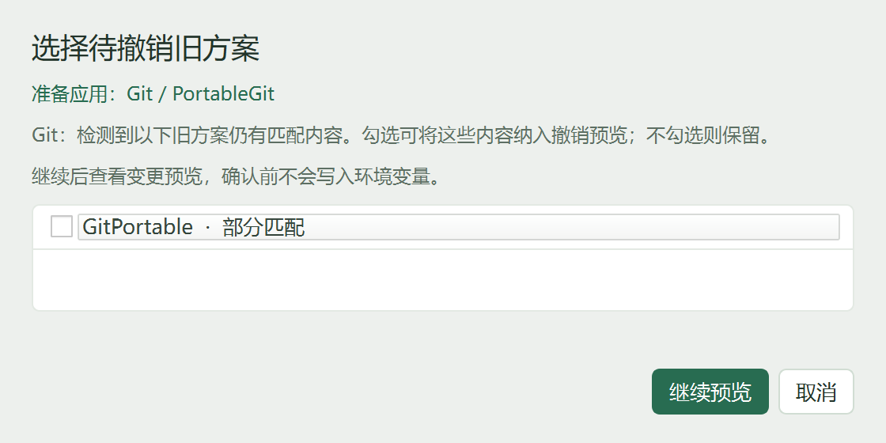

# 旧方案撤销候选资格修复

应用 `Git / PortableGit` 时，如果另一个方案 `GitPortable` 的 Path 元素在 Windows 中全部不存在，原实现仍会弹出“部分匹配旧方案”选择框。原因是检测三态中的 PARTIAL 也包含“变量键存在、要求内容零命中”，切换流程直接把它当作可撤销旧方案。

本次保持检测三态不变。切换的检测快照和冻结输入两条路线共用资格函数，复用 `build_removal_atoms`；部分匹配方案必须产生真实撤销 atom 才进入选择列表。实际选定值和原始 Windows 快照参与计算，不使用默认值替代运行草稿，不重新读取或写入注册表。完整候选歧义、共同元素保留、共享保护和执行前再验证沿用已有流程。

普通模式、special 和空普通值均沿用 `removal.py` 当前规则。共同元素仍可使部分旧方案具有候选资格，最终净变更由原有合成与保护流程决定。此修复不按净差异额外过滤候选。

真实残留选择框补充当前准备应用的应用/方案，并明确继续后查看变更预览、确认前不会写入；“继续”改为“继续预览”，默认窗口改为 560×280。

## 验证

- 本机全套：`python -m unittest discover -s tests -q`，590 项，49.376 秒，OK。
- 回归覆盖：零命中旧 Path 在单应用和批量应用中直接进入预览；显式选择零命中方案被拒绝；真实部分残留仍需明确选择；各普通模式、special、精确空值、不同于默认值的当前选定值、共同元素、多完整候选及陈旧快照保持既有行为。
- Windows 原生应用流程：公开合成 TOML、MemoryStore 和一次性状态目录，100%/150%/200% 三档均验证原生窗口可见。零命中单/批应用到达 PreviewDialog；真实残留到达 OldSchemeDialog。取消后每个场景均为零写入、零通知，state、history、TOML 校验和不变。
- 原生测量记录：[old-scheme-candidates-report.json](compact-ui-evidence/old-scheme-candidates-report.json)。复现脚本：`tools/capture_old_scheme_candidates.py`。
- 本机个人配置和环境仅作只读命中核查，没有执行真实环境变更；安装版 EXE/UAC/发布包未在此次更新验收。

200% 原生示例：

