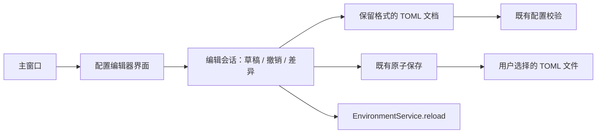

# TOML 配置编辑器架构

## 目标与边界

在现有应用 → 方案 → 环境变量模型上，提供添加、修改、重命名、移动和删除变量的可视化表单；支持默认值、作用域、四种模式、编辑权限、候选列表及可选 special 属性。用户可以编辑原始 TOML，并在保存前查看差异。表单编辑与原始文本共用一个草稿。

编辑器只负责配置文件。删除配置记录不删除 Windows 变量，不撤销已应用方案，也不清除成功应用值和恢复历史。保存后调用现有 `EnvironmentService.reload()`，由现有选择层处理定义变化并使旧执行计划失效。

## 模块划分

| 模块 | 职责 | 依赖 |
| --- | --- | --- |
| `config_document.py` | 保留注释和未修改布局的 TOML 文档、变量 CRUD、单/双作用域转换、空分组清理 | `models.py`、`config.py`、tomlkit |
| `config_editing.py` | 内存草稿、撤销/重做、原始文本同步、差异、磁盘外部变更检测、显式保存与运行时刷新 | 文档层、现有配置校验/原子保存接口 |
| `config_editor_ui.py` | 应用/方案/变量树、变量表单、候选项编辑、原始文本、差异预览、未保存提示 | 编辑会话，不直接操作注册表或状态库 |
| `ui.py` | 主窗口“配置编辑器”入口；原始配置入口打开同一编辑器的源码页 | 编辑器界面 |
| `config.py`（既有） | 唯一的完整配置校验及原子文件写入规则 | 既有纯引擎、模型 |

## 编辑与保存流程

1. 从文件原始字节建立基线与草稿。浏览记录不改变文档。
2. 表单可以暂时输入非法内容；记录进入草稿前，对编辑后的全部应用、全部方案检查同一目标 special 一致性及 special 仅允许 replace。校验失败保持原草稿和历史，表单输入供修正。跳转、删除或保存前处理尚未加入草稿的表单输入。
3. 新变量可以选择已有应用/方案，也可以同时创建新的应用/方案。名称通过 TOML 键编码保存，不拼接裸表头。
4. 同一方案内同名且不同作用域的两条记录自动组成双内联表数组；删除一条时折叠为剩余单内联表。大小写不同的同名变量共用一个 TOML 键，重复作用域拒绝加入。
5. 修改默认值、模式及 special 等字段保留不相关变量、注释及结构。字符串不修剪、不展开引用、不规范化路径；特殊默认值及候选值通过精确文本编辑器原样往返，special 位于变量记录而不位于 choices。复制、移动与重命名也重新校验整份配置。
6. 删除最后一条记录同时移除空方案及空应用。完全空的草稿可以撤销或继续添加，但不能保存为现有模型不支持的空配置。
7. 表单和源码页通过会话同步，源文本非法时保留输入并展示错误，不用旧表单内容覆盖源文本。
8. 保存前校验完整草稿，展示差异；使用同目录的 `.<配置文件名>.edit.lock` 协调多个编辑器保存，并在原子替换前再次核对磁盘原始字节。外部修改时停止保存，让用户重新加载或保留草稿。
9. 保存调用现有原子写入；运行时刷新失败时保留磁盘原文件和旧运行时状态。保存成功更新基线，清空撤销栈并刷新主窗口。
10. 保存接口返回异常时核对实际文件：如果原子替换已经完成且磁盘字节等于草稿，保留新运行时并报告已核实保存的异常；未保存则恢复旧运行时，无法确认时保留草稿并报告问题。
11. 取消/关闭未保存会话时明确处理草稿；没有确认保存的编辑不会写入文件。

## 关键接口

`ConfigurationDocument(text)` 提供 `text`、`groups()`、`records(app, option)`、`put_record(spec, original=None)`、`delete_record(spec)`、`delete_group(app, option=None)`。命令执行失败时原文档保持不变；`VariableSpec`/`Choice` 复用既有模型。

`ConfigEditingSession(path)` 提供 `text`、`dirty`、`document`、`replace_text(text)`、`replace_source_text(displayed_text)`、`put_record()`、`delete_record()`、`delete_group()`、`undo()`、`redo()`、`validate()`、`diff()`、`reload_from_disk()`、`save(service)`。非法源码属于未提交草稿，不用于构建可视化文档。源码输入保留未改行的原始分隔符；编辑既有行沿用该行分隔符，新增行沿用文件主要换行格式。

## 验证范围

文档测试覆盖注释/字符串保留、变量新增修改删除、重命名与跨方案移动、双作用域转换、重复检测及最后记录删除。会话测试覆盖撤销/重做、源码错误保留、取消零写入、外部变更、保存失败、运行时刷新失败及状态隔离。界面测试从主窗口打开编辑器，通过真实会话执行 CRUD、候选项编辑和保存，重新加载配置核对结果；使用内存注册表证明编辑配置不执行 Windows 变更。最后运行全套回归测试并检查编辑器截图。

格式保留使用 [tomlkit 的文档解析和修改接口](https://tomlkit.readthedocs.io/en/latest/quickstart/)；完整格式与字段合法性仍由项目自身的 `parse_config()` 决定。
